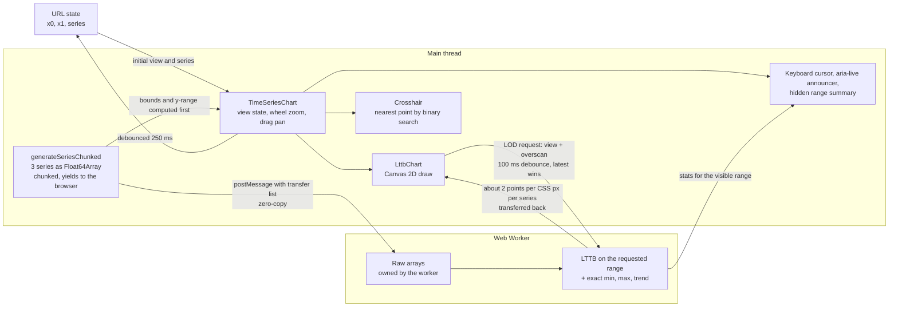

# timeseries-viewer

[](https://github.com/byteKumar/timeseries-viewer/actions/workflows/ci.yml)

A React and TypeScript chart that stays responsive with 3 series of 1M or 5M points each (up to 15M points), with pan, zoom, a crosshair tooltip, URL permalinks and keyboard and screen-reader support.

## Results at a glance

All numbers are measured; method and raw runs are in [RESULTS.md](RESULTS.md).

- At 5M points per series, render time fell from 4522 ms (SVG baseline) to 44 ms (canvas + LTTB in a Web Worker).
- Main-thread blocking during a scripted 5 s pan and zoom at 5M fell from 5194 ms to 0 ms.
- With LTTB, interaction runs at 60.1 fps with 40 ms INP at both sizes. Both are the limits of the setup (60 Hz display, 40 ms harness floor), not of the code.
- Lighthouse (local production build, mobile preset): performance 100, TBT 0 ms. It was 91 and 370 ms before the demo's data generation was chunked.
- axe (WCAG 2.1 A/AA): 0 violations. 47 unit tests and 22 Playwright tests pass in CI.

## Architecture



| module | what it does |
|---|---|
| `src/data/generate.ts` | Seeded generator (sine + noise + spikes); one-shot and chunked versions produce identical data. |
| `src/data/useDataset.ts` | Generates the data, computes bounds, transfers the arrays to a new worker for the LTTB renderer. |
| `src/lttb/lttb.ts`, `search.ts` | LTTB downsampling; lower/upper bound and nearest-point binary searches. |
| `src/lttb/lttb.worker.ts`, `client.ts` | Worker that owns the raw data; client with one request in flight ("latest wins"). |
| `src/chart/` | Renderers (`SvgChart`, `CanvasChart`, `LttbChart`), viewport math, crosshair, keyboard logic. |
| `src/a11y/` | Range statistics for the screen-reader summary; WCAG contrast checks. |
| `src/permalink.ts` | Parses and writes the URL state, validating it as user input. |
| `bench/run.ts` | Benchmark harness (render time, fps, INP, long tasks). |

## Approach

| decision | why | trade-off |
|---|---|---|
| Start with an SVG baseline (one `<path>` per series with every point) | Gives a measured "before" for every later step. | At 5M the scripted interaction got 0 drag steps through in 5 s. |
| Canvas instead of SVG | Canvas is a bitmap: no DOM geometry to store, lay out or hit-test. | No built-in element events, styling or accessibility; the crosshair and screen-reader support had to be built by hand. Drawing every point still costs 3M–15M `lineTo` calls per frame. |
| The worker owns the raw data | The `Float64Array`s are transferred once (zero-copy). The worker runs LTTB and the main thread only draws about 7,200 points. | The main thread loses the raw data. The tooltip searches the points on screen, and the exact min/max/trend for screen readers is computed in the worker, which raised LTTB render time from 16 to 29 ms (1M). |
| Level-of-detail scheduling | Each view change redraws the current points stretched right away, then requests fresh detail 100 ms after the view settles, with one view-width of overscan on each side and one request in flight. | Up to 100 ms of coarser lines after a zoom, in exchange for 3–6 worker requests per benchmark run instead of about 200, and real data at the edges of short pans. |
| Canvas accessibility | A focusable plot with `role="application"` so arrow keys reach it; a keyboard cursor stored as a timestamp, so it survives level-of-detail changes; a debounced `aria-live` announcer; a hidden summary of the visible range. | Screen readers don't read content inside an application role, so everything goes through the label, description and live region. |
| Chunked data generation | Generating 3M points in one task blocked page load (Lighthouse TBT 370 ms). Chunks of 65,536 samples yield with `scheduler.yield()`. | Yielding adds scheduling overhead to generation (not measured separately); the data is identical (unit-tested). |

**Benchmark method.** `bench/run.ts` drives headed Google Chrome 157 with Playwright against the production build, at 1280×800 and devicePixelRatio 2, with a fresh browser context per run and the median of 3 runs per cell. It refuses to run while another benchmark, load test or training job is running, or when the 1-minute load average is 4 or more.
- **render ms:** from data ready to first paint.
- **fps:** `requestAnimationFrame` rate during a scripted 5 s of wheel zoom and drag pan.
- **INP:** web-vitals INP after 10 clicks on "Zoom in"; wheel events don't count toward INP.
- **block ms:** sum of (duration − 50 ms) over long tasks in the same 5 s.

## Results

Apple M3 (8 cores, 16 GB), Chrome 157.0.8103.52. "1M" means 1M points per series (3 series).

**Measured at each milestone** (each row on that milestone's code):

| step | 1M render ms | 1M fps | 1M INP ms | 1M block ms | 5M render ms | 5M fps | 5M INP ms | 5M block ms |
|---|---|---|---|---|---|---|---|---|
| SVG baseline | 898 | 19.0 | 136 | 2564 | 4522 | 2.8 | 136 | 5194 |
| canvas, every point | 136 | 39.8 | 120 | 123 | 382 | 13.5 | 224 | 3019 |
| canvas + LTTB worker | 16 | 60.1 | 40 | 0 | 44 | 59.9 | 40 | 0 |

**Re-measured on the finished code**, all renderers in one sitting (load average 2.63):

| renderer | 1M render ms | 1M fps | 1M INP ms | 1M block ms | 5M render ms | 5M fps | 5M INP ms | 5M block ms |
|---|---|---|---|---|---|---|---|---|
| SVG | 930 | 18.8 | 176 | 2589 | 4393 | 2.9 | 168 | 4095 |
| canvas | 146 | 40.9 | 144 | 44 | 351 | 13.8 | 224 | 2965 |
| canvas + LTTB worker | 29 | 60.1 | 40 | 0 | 72 | 60.1 | 40 | 0 |

- **Canvas made INP at 5M worse than SVG** (136 → 224 ms). The full redraw runs on the main thread inside the click's frame.
- **SVG's click INP hides its wheel and drag cost.** Clicking a button doesn't hit-test the giant path; wheel and drag events do.

**Lighthouse** (local production build, mobile preset, 3 runs, LHCI's median run). The budget was set before the first run: performance ≥ 0.9, LCP ≤ 2.5 s, TBT ≤ 200 ms, CLS ≤ 0.1, accessibility ≥ 0.9.

| | performance | accessibility | LCP | TBT | CLS | budget |
|---|---|---|---|---|---|---|
| before (data generated in one task) | 0.91 | 1.00 | 1202 ms | 370 ms | 0 | failed (TBT) |
| after (chunked generation) | 1.00 | 1.00 | 1202 ms | 0 ms | 0 | passed |

Per-milestone notes, raw files and every caveat are in [RESULTS.md](RESULTS.md).

## How to run

Requires Node 24 and Google Chrome. The tests and benchmarks drive your installed Chrome, so no Playwright browser download is needed.

```bash
npm install
```

```bash
npm run dev
```

Open http://localhost:5173. Use the 1M / 5M buttons and the renderer menu (`lttb`, `canvas`, `svg`).

| command | what it does |
|---|---|
| `npm test` | unit tests (Vitest) |
| `npm run test:e2e` | Playwright tests and the axe scan, against the production build |
| `npm run build && npm run preview` | production build at http://localhost:4173 |
| `npm run build && npm run bench` | the benchmark (opens headed Chrome windows; refuses to run while the machine is busy) |
| `npm run lighthouse` | Lighthouse CI with the budget in `lighthouserc.json` |
| `npm run storybook` | Storybook at http://localhost:6006 |

Keyboard, once the chart has focus:
- ←/→ move between points; Shift+←/→ or Page Up/Down jump 10% of the view.
- ↑/↓ switch series; Home/End go to the first/last point in view.
- +/− zoom; Escape clears the cursor.

## Tests and CI

- **Unit tests (47, Vitest):** generator, viewport math, canvas mapping, LTTB (first and last point, extremes, output length), binary search, permalinks, keyboard logic, range statistics, contrast.
- **Playwright tests (22):** zoom, pan and tooltip for each renderer, keyboard navigation, the hidden summary, permalink restore, the 5M button, level-of-detail refresh, and an axe scan.
- **CI:** [`.github/workflows/ci.yml`](.github/workflows/ci.yml) runs typecheck, unit tests, Playwright and Lighthouse CI with the budget. Passing run: [43929156757](https://github.com/byteKumar/timeseries-viewer/actions/runs/43929156757).
  - On CI, Playwright runs at devicePixelRatio 1, because GitHub's runners have no GPU and the all-points canvas baseline at 2× is very slow in software. Local runs use 2×. The reason is documented in `playwright.config.ts`.

## Limitations

- **No hosted demo yet:** the demo page runs locally with `npm run build && npm run preview`.
- **fps is capped** by the 60 Hz display, and **INP has a 40 ms floor** in this harness. Neither can separate the LTTB renderer from anything faster.
- **No manual screen-reader check** with VoiceOver or NVDA.
- **No Chrome performance traces.** The explanations of the SVG click-versus-wheel gap, canvas's worse INP at 5M, and the INP rise on the finished code are inferred from the numbers.
- **One sitting per table:** each cell is one median of 3 runs. Lighthouse was 3 runs on a local build, not a deployed URL.
- **CI covers 1× only:** CI runs the end-to-end tests at 1× pixel density; 2× is covered locally and by a unit test.
- **Slow SVG tests on CI:** on the runner the SVG baseline's tests take up to 32.6 s of the 60 s timeout.
- **One glitch not reproduced:** coarse lines in one Storybook story were seen once.
